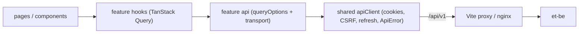

# rt-fe

**Accessible, mobile-first single-page application built with React 19 and TypeScript, using a
feature-sliced architecture, TanStack Query and a token-based design system.**


<!-- CI badge (set once the repository exists):
 -->

## Table of contents

1. [Overview](#overview)
2. [Features](#features)
3. [Route map](#route-map)
4. [Architecture](#architecture)
5. [Tech stack](#tech-stack)
6. [Getting started](#getting-started)
7. [Configuration](#configuration)
8. [Scripts](#scripts)
9. [Project structure](#project-structure)
10. [Design system](#design-system)
11. [Testing](#testing)
12. [CI/CD and branching](#cicd-and-branching)
13. [Deployment](#deployment)
14. [Security](#security)
15. [Contributing](#contributing)
16. [Documentation](#documentation)

## Overview

rt-fe is the frontend of the fs-reustemp full-stack workspace. It talks to the et-be API through a
same-origin proxy (`/api/v1`), never handles tokens itself, and can be developed against a
contract-following mock API while backend endpoints are still in progress.

- **Feature-sliced**: every feature is an isolated vertical slice; boundaries are enforced by lint.
- **Secure by default**: httpOnly cookie sessions, CSRF echo, single-flight token refresh, strict CSP,
  no tokens or auth data in browser storage.
- **Fast**: route-level code splitting with prefetch, cached server state, Web Vitals budgets.
- **Inclusive**: mobile-first from 320 px, WCAG 2.2 AA, keyboard paths, reduced-motion support, en/fr.
- **No offline layer by design**: no service worker or PWA (decision record 0001).

## Features

<!-- AUTO-GENERATED:FEATURES:START -->
<!-- Do not edit by hand: generated by `npm run docs:readme` from docs/. -->

| Feature | Status | Since | Summary |
|---|---|---|---|
| [Web platform foundation](docs/features/platform.md) | in-progress | - | Shared layer every feature uses - HTTP client with cookie session, CSRF and silent refresh, typed API errors, i18n (en, fr), theme and the MSW test harness. |
| [Authentication](docs/features/auth.md) | planned | - | Sign in and sign out with cookie sessions, session bootstrap on load, automatic token refresh and guarded routes. |
| [Home](docs/features/home.md) | planned | - | Signed-in landing page that completes the login -> home -> logout flow on the empty template. |

<!-- AUTO-GENERATED:FEATURES:END -->

Feature pages: [docs/features/](docs/features/). Release history: [CHANGELOG.md](CHANGELOG.md).

## Route map

<!-- AUTO-GENERATED:ROUTES:START -->
<!-- Do not edit by hand: generated by `npm run docs:readme` from docs/. -->

| Route | Access | Feature | Status |
|---|---|---|---|
| `/` | protected | [Home](docs/features/home.md) | planned |
| `/login` | guest | [Authentication](docs/features/auth.md) | planned |

<!-- AUTO-GENERATED:ROUTES:END -->

Access: `public` (anyone), `guest` (signed-out only), `protected` (signed-in), `role:<name>` (signed-in with role).
Authorization is always enforced by the API; guards only shape the experience.

## Architecture



| Layer | Responsibility |
|---|---|
| `app/` | Providers, error boundary, session gate |
| `routes/` | Route tree, guards, lazy page registry |
| `layouts/` | Page shells with slots |
| `features/<name>/` | api, hooks, components, pages of one capability |
| `shared/` | apiClient, types, generic components and hooks, stores, i18n |
| `styles/` | Design tokens, breakpoints, global reset |

Details: [docs/architecture.md](docs/architecture.md).

## Tech stack

| Concern | Choice |
|---|---|
| UI | React 19, TypeScript 5.9 (strict), CSS Modules on design tokens, lucide icons, motion |
| Build | Vite 8, PostCSS (`@custom-media`) |
| Routing | React Router 7 (native lazy routes, guards) |
| Server state | TanStack Query 5 (`queryOptions` per feature) |
| Client state | Zustand 5 (session identity, theme) |
| Forms | react-hook-form + zod |
| HTTP | axios (single `apiClient`) |
| i18n | i18next + react-i18next (en, fr) |
| Tests | Vitest, Testing Library, MSW (Node) |
| Quality | ESLint 9 (boundaries, react-hooks), oxlint, stylelint, policy script |
| Delivery | Docker (unprivileged nginx), GitHub Actions, GHCR, Trivy, CodeQL, gitleaks |

## Getting started

**Prerequisites:** Node.js 22 (`.nvmrc`). Optional: a running et-be on port 4000.

```bash
cp .env.example .env
npm install                 # creates package-lock.json - commit it
npm run dev                 # http://localhost:3000 (proxies /api to et-be on :4000)
```

No backend yet? `npm run mock` (port 4001) and set `VITE_USE_MOCK=true` in `.env`. Sign in with
`admin@example.test` / `mock-password`. Details: [mock/README.md](mock/README.md).

## Configuration

`VITE_API_BASE_URL`, `VITE_DEFAULT_LOCALE` (read by the app), `VITE_BACKEND_UPSTREAM`, `VITE_USE_MOCK`,
`VITE_MOCK_UPSTREAM` (dev proxy), `BACKEND_UPSTREAM` (container). Every `VITE_*` value is public.
Full reference: [docs/configuration.md](docs/configuration.md).

## Scripts

| Script | Purpose |
|---|---|
| `npm run dev` / `npm run preview` | Dev server / serve the production build |
| `npm run build` | Typecheck (project references) + production build |
| `npm run verify` | **Local pipeline** (lint, policy, docs check, typecheck, tests, build) - run before every push |
| `npm run lint` | ESLint + oxlint + stylelint (zero warnings) |
| `npm run check:policy` | No PWA files/packages, no color/font literals in code |
| `npm test` / `npm run test:watch` | Vitest |
| `npm run mock` | json-server mock API on port 4001 |
| `npm run docs:readme` / `docs:check` | Regenerate / verify the generated README sections |

## Project structure

```
src/
  main.tsx                 entry
  app/                     providers, error boundary
  routes/                  paths, lazy page registry, router, guards, route error
  layouts/                 AppLayout, AuthLayout (slots)
  features/<name>/         api/, hooks/, components/, pages/
  shared/                  lib/ (apiClient...), types/, components/, hooks/, store/, i18n/
  styles/                  tokens.css, breakpoints.css, global.css
  test/                    setup, render helper, MSW server + handlers
mock/                      contract-following json-server mock
docker/nginx/              nginx template + security headers
scripts/                   policy and documentation scripts
docs/                      architecture, design system, configuration, feature pages
```

## Design system

Colors, fonts, spacing, radii, shadows and motion are tokens in `src/styles/tokens.css` (light and dark
themes); breakpoints are `@custom-media` in `src/styles/breakpoints.css`. Components are four co-located
files (structure, styles, i18n data, logic). Reference: [docs/design-system.md](docs/design-system.md).

## Testing

Component and hook tests with Vitest and Testing Library, rendered through `renderWithProviders`.
Network calls are intercepted by MSW in Node mode, so tests exercise the real `apiClient`
(CSRF, refresh, error normalization). No live backend, no browser service worker.

## CI/CD and branching

- One branch per task: `feature/`, `fix/`, `refactor/`, `perf/`, `test/`, `docs/`, `chore/`, `ci/` from `dev`;
  `hotfix/` from `main`. Commits: `type(<task>): summary`.
- Push to a work branch: **verify** (lint, policy, typecheck, tests, boundaries report, dependency audit,
  secret scan, README docs check), then a PR into `dev` with auto-merge.
- Pull requests: verify + Docker build and Trivy scan. `main`: verify + image published to GHCR.
  Weekly CodeQL. `dev` -> `main` promotion is a manual workflow.

## Deployment

Static build served by unprivileged nginx on port 8080. Set `BACKEND_UPSTREAM` at run time to point
`/api` and `/socket.io` at et-be; one image serves every environment. Health: `GET /healthz`.
Hashed assets are cached for a year; `index.html` is never cached.

## Security

No tokens in JavaScript (httpOnly cookies), CSRF header on every write, single-flight refresh,
strict Content Security Policy and security headers from nginx, lint bans on `dangerouslySetInnerHTML`,
inline styles, `window.open` and auth data in web storage, validated external URLs (`safeOpen`).
Report vulnerabilities privately to the repository owner.

## Contributing

1. Work from a task brief (`contracts/tasks/` in the workspace) on its branch.
2. Follow the file contract in [AGENTS.md](AGENTS.md) and the standards in
   [AGENTS-SENIOR-FRONTEND.md](AGENTS-SENIOR-FRONTEND.md).
3. Update the feature page in `docs/features/`, add a CHANGELOG line, run `npm run docs:readme`.
4. `npm run verify` must be green before pushing. No AI attribution in commits, branches or PRs.

## Documentation

| Document | Content |
|---|---|
| [docs/README.md](docs/README.md) | Documentation index |
| [docs/architecture.md](docs/architecture.md) | Layers, data flow, patterns, decisions |
| [docs/design-system.md](docs/design-system.md) | Tokens, themes, breakpoints, components |
| [docs/configuration.md](docs/configuration.md) | Environment variables, proxy, container |
| [docs/features/](docs/features/) | One page per feature |
| [CHANGELOG.md](CHANGELOG.md) | Release history |

## License

Proprietary unless the owner adds a `LICENSE` file.
