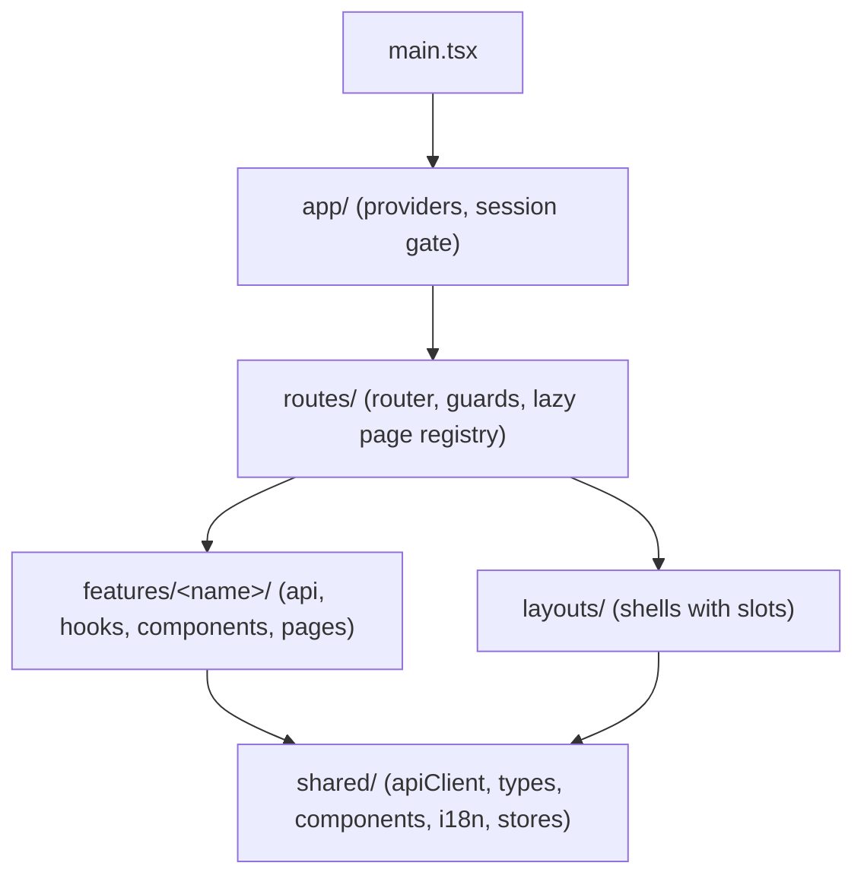

# Architecture

rt-fe is a feature-sliced single-page application. Each feature is a vertical slice (api, hooks,
components, pages); features never import each other; shared code lives in `shared/`. The rules are
enforced by ESLint (`eslint-plugin-boundaries`, import bans), stylelint and a policy script.
Exhaustive file-level rules: [../AGENTS.md](../AGENTS.md).

## Layers



| Layer | Responsibility | May import |
|---|---|---|
| `app/` | Providers, error boundary, session gate | routes, shared |
| `routes/` | Route tree, guards, lazy page registry, route error UI | layouts, features, shared |
| `routes/paths.ts`, `prefetchRoute.ts` | Route strings and chunk prefetch, usable everywhere | routes |
| `layouts/` | Page shells; feature UI arrives through slot props | shared |
| `features/<f>/` | One business capability end to end | same feature, shared |
| `shared/` | apiClient, types, generic components/hooks, global UI stores, i18n | shared |

## Data flow

```
page -> component -> use<Component> logic hook -> feature hook (useQuery / useMutation)
     -> <feature>Queries (queryOptions) -> <feature>Api -> apiClient
     -> /api/v1/... (cookies, X-CSRF-Token, single-flight refresh on 401) -> proxy -> et-be
errors -> ApiError { status, code } -> UI branches on code -> t('errors.<CODE>')
```

## Key patterns

- **Route-level code splitting** with React Router 7 `lazy` + hover/focus prefetch.
- **Server state** in TanStack Query through per-feature `queryOptions` factories (keys + fetchers together).
- **Session identity** in a small Zustand store written only by auth hooks; never persisted.
- **Four-file components**: structure (`.tsx`), presentation (`.module.css`), data (`.data.json`, i18n keys),
  logic (`use<Thing>.ts`).
- **Dependency injection without upward imports**: `configureApiClient({ onSessionExpired })` registered by `App`.

## Cross-cutting decisions

| Topic | Decision | Source |
|---|---|---|
| Offline / PWA | Permanently excluded | workspace ADR 0001 |
| Auth | httpOnly cookies, CSRF echo, single-flight refresh | workspace ADR 0002 |
| API shape | `/v1`, `{ error, code }`, cursor pagination | workspace ADR 0003 |
| Scale & tenancy | applied per project profile | `AGENTS-SENIOR-FRONTEND.md` section 0.3 |
